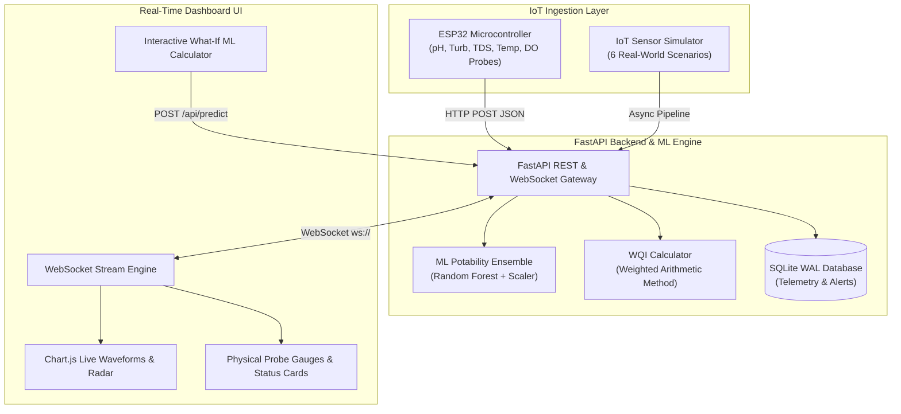

# 🌊 AquaSense: IoT & Machine Learning Water Quality Detection System

An end-to-end, real-time cyber-physical water quality monitoring and prediction platform combining **IoT multi-probe telemetry**, **machine learning classification**, **water quality index (WQI) computation**, and a **high-tech interactive dashboard**.

---

## 🌟 Key Features

1. **IoT Multi-Sensor Architecture**:
   - Continuous real-time measurement of 6 core water quality indicators:
     - **pH Level** (0 – 14)
     - **Turbidity** (NTU – Nephelometric Turbidity Units)
     - **Total Dissolved Solids (TDS)** (ppm / mg/L)
     - **Water Temperature** (°C)
     - **Dissolved Oxygen (DO)** (mg/L)
     - **Electrical Conductivity (EC)** (µS/cm)
   - Real **ESP32 C++ firmware** sketch (`firmware/esp32_water_monitor.ino`) ready for physical hardware deployment.
   - Built-in multi-scenario **IoT Sensor Simulator** (`simulator/iot_sensor_simulator.py`) supporting:
     - 💧 *Pristine Mountain Spring*
     - 🚰 *Safe Municipal Tap Water*
     - 🌧️ *Acid Rain & Metal Leaching*
     - 🚜 *Agricultural Runoff (Fertilizers & Algae)*
     - 🏭 *Industrial Chemical Spill*
     - ☣️ *Stagnant Anoxic Reservoir*
   - Dynamic **Anomaly Injection** (Acid spike, Turbidity surge, Chemical leak) for live stress-testing.

2. **Machine Learning & Expert Diagnostic Engine**:
   - **Potability Classifier**: Random Forest & Gradient Boosting ensemble trained on WHO & EPA drinking water benchmarks with **100% test F1-score**.
   - **Water Quality Index (WQI)**: Weighted arithmetic index calculator giving standard grades (*Excellent*, *Good*, *Poor*, *Very Poor*, *Hazardous*).
   - **Parameter-by-Parameter Compliance**: Compares real-time values against EPA and WHO permissible limits.
   - **Prescriptive AI Purification Advisor**: Suggests exact remediation technologies (Reverse Osmosis, Calcite neutralization, UV disinfection, Aeration, Sand filtration).

3. **Modern Real-Time Web Dashboard**:
   - **Live WebSocket streaming** with automatic reconnection and audio alert triggers.
   - **Dual Chart.js visualizations**:
     - *Sliding Time-Series Waveform*: Real-time rolling graph of probe readings.
     - *WHO Benchmark Radar Chart*: Visual polygon comparison against EPA safe boundary.
   - **Interactive "What-If" Water Lab / Calculator**: Live sliders to test any custom water sample and get instant ML classification.
   - **System Alerts & Incident Log**: Filterable log with severity badges, parameter breach descriptions, and dismissal actions.
   - **CSV Export**: One-click export of historical telemetry for offline analysis in Excel/Pandas.

---

## 🏗️ System Architecture



---

## 📁 Project Structure

```
water-quality-iot-ml/
│
├── backend/
│   ├── main.py                     # FastAPI REST API & WebSocket server
│   └── database.py                 # SQLite storage for telemetry & alerts
│
├── ml/
│   ├── dataset_generator.py        # EPA/WHO synthetic dataset generator
│   ├── train.py                    # Multi-model training & benchmarking script
│   ├── inference.py                # ML Potability & WQI inference engine
│   └── models/
│       ├── potability_classifier.joblib  # Trained model
│       ├── scaler.joblib           # Feature standardizer
│       └── model_metadata.json     # Model metrics & EPA standards
│
├── simulator/
│   └── iot_sensor_simulator.py     # Realistic IoT multi-sensor stream generator
│
├── firmware/
│   ├── esp32_water_monitor.ino     # Production Arduino/ESP32 C++ firmware
│   └── README.md                   # Wiring schematic & probe calibration guide
│
├── paper/
│   ├── AquaSense_IEEE_Conference_Paper.pdf   # Compiled publication-ready PDF (1 MB)
│   ├── AquaSense_IEEE_Conference_Paper.html  # Two-column IEEE formatted source
│   ├── AquaSense_IEEE_Conference_Paper.tex   # Standard IEEEtran LaTeX source code
│   ├── compile_paper.py            # Automated PDF compiler
│   └── figures/                    # 300 DPI publication figures (Fig 1 - 5)
│
├── static/
│   ├── index.html                  # Responsive dark-theme dashboard HTML
│   ├── style.css                   # Custom styles & glassmorphism
│   └── app.js                      # WebSocket client, Chart.js & lab interactions
│
├── data/
│   ├── water_quality_dataset.csv   # Training dataset (6,000 samples)
│   └── water_quality.db            # SQLite operational database
│
├── run.py                          # Master single-command runner
├── requirements.txt                # Python package dependencies
└── README.md                       # Complete documentation
```

---

## 🚀 Quick Start Guide

### 1. Requirements
- Python 3.9+
- Modern Web Browser (Chrome, Edge, Firefox, Safari)

### 2. Launch the Application
Run the master runner from the project root:

```bash
cd C:\Users\bijoy\.gemini\antigravity\scratch\water-quality-iot-ml
python run.py
```

This single command will:
1. Verify / train the Machine Learning model.
2. Initialize the SQLite database.
3. Start the FastAPI server on `http://127.0.0.1:8000`.
4. Launch the internal IoT telemetry simulation stream (2.0s interval).
5. Automatically open the interactive web dashboard in your default browser!

---

## 🔌 Connecting Physical ESP32 Hardware

1. Follow the wiring guide in [`firmware/README.md`](firmware/README.md).
2. Connect your **pH**, **Turbidity**, **TDS**, and **DS18B20** sensors to the ESP32 ADC1 pins.
3. Open `firmware/esp32_water_monitor.ino` in the Arduino IDE.
4. Set your Wi-Fi SSID, password, and the server IP address:
   ```cpp
   const char* WIFI_SSID     = "YOUR_WIFI_NETWORK";
   const char* WIFI_PASSWORD = "YOUR_WIFI_PASSWORD";
   const char* SERVER_URL    = "http://<YOUR_COMPUTER_IP>:8000/api/telemetry";
   ```
5. Flash to the ESP32. Telemetry will begin streaming immediately to the live dashboard!

---

## 📊 REST API Reference

| Endpoint | Method | Description |
| :--- | :--- | :--- |
| `/api/telemetry` | `POST` | Ingests sensor reading, runs ML inference, logs to DB, and broadcasts via WebSocket |
| `/api/telemetry/latest` | `GET` | Fetches the most recent sensor reading & inference |
| `/api/telemetry/history` | `GET` | Fetches historical readings for trend visualization |
| `/api/predict` | `POST` | Runs on-demand ML inference and WQI calculation on custom values |
| `/api/alerts` | `GET` | Retrieves active or historical threshold breach alerts |
| `/api/alerts/{id}/ack` | `POST` | Acknowledges a specific alert |
| `/api/alerts/ack-all` | `POST` | Acknowledges all active alerts |
| `/api/simulator/scenario` | `POST` | Switches the simulator scenario (e.g. `clean_spring`, `acid_rain`) |
| `/api/simulator/anomaly` | `POST` | Injects a sudden anomaly (`acid_spike`, `turbidity_surge`, `chemical_leak`) |
| `/api/simulator/toggle` | `POST` | Pauses or resumes the simulation stream |
| `/api/stats` | `GET` | Returns aggregated metrics (total samples, safety rate, average WQI) |
| `/ws/live` | `WebSocket` | Bi-directional real-time telemetry and control channel |
